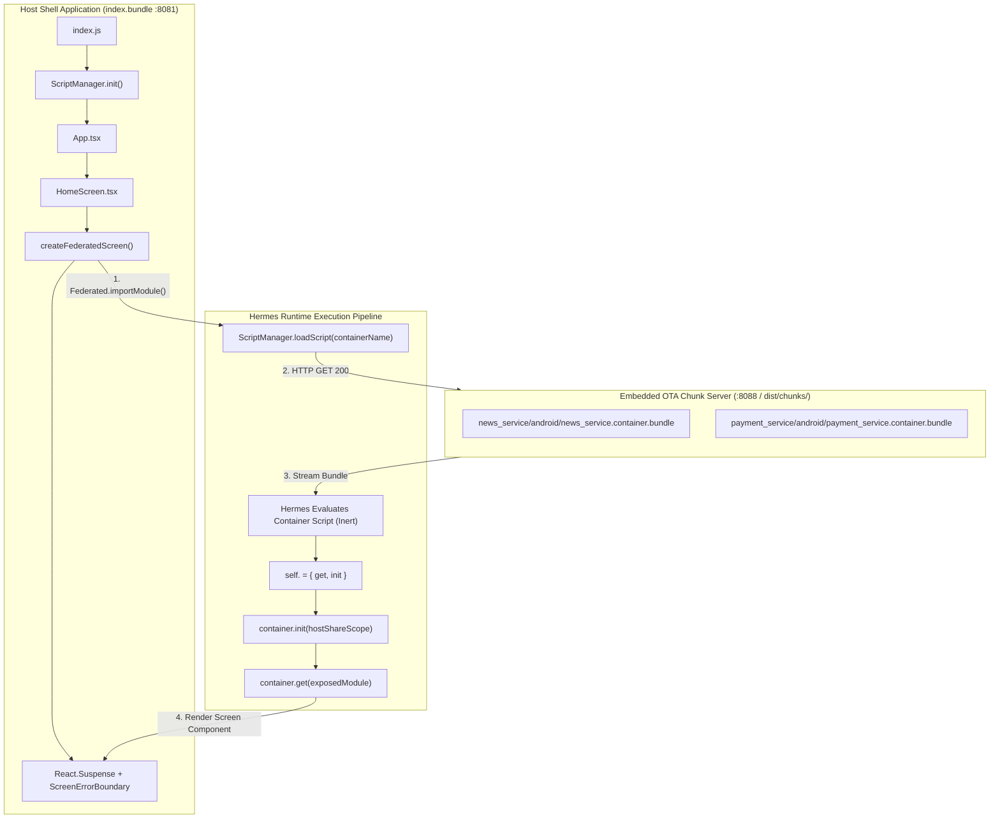

# Architecture & Implementation Specification: Re.Pack Micro-Frontend SuperApp

> **Target Project:** `experimental`  
> **Framework:** React Native `0.80.3` (Hermes Engine, Clean Architecture)  
> **Bundler:** Re.Pack `5.4.2` powered by `@rspack/core` `1.7.12`  
> **Federation Engine:** Webpack / Rspack Module Federation v1  

---

## 1. System Overview & Architecture

This project implements a production-grade Native Micro-Frontend / Mini-Apps architecture using **Re.Pack 5** and **Module Federation**.

The system decouples feature modules into independent dynamic containers that are compiled into self-contained bundles, hosted remotely, and loaded on-demand over-the-air (OTA) via HTTP/CDN.



---

## 2. Directory Structure

```
/Users/mac/PROJECTS/JULY/experimental/
├── SPEC.md                           # Architecture, operation & lifecycle specification
├── package.json                      # Dependency definitions & automated scripts
├── react-native.config.js            # Re.Pack CLI integration
├── rspack.config.mjs                 # Unified Rspack bundler & Module Federation configuration
├── index.js                          # Host app entrypoint (initializes ScriptManager)
├── App.tsx                           # Root app component
├── dist/                             # Output directory for compiled remote chunks
│   └── chunks/
│       ├── news_service/android/     # News container bundle (~65 KiB)
│       └── payment_service/android/  # Payment container bundle (~65 KiB)
├── tools/
│   └── build-miniapps.js             # Programmatic Rspack multi-container builder
└── src/
    ├── repack/
    │   ├── containerEntry.ts         # Inert entry point for containers
    │   └── scriptManager.ts          # ScriptManager resolver & URL locator with retries
    ├── components/
    │   ├── FederatedScreen.tsx       # Suspense & ErrorBoundary wrapper
    │   └── SkeletonLoader.tsx        # Fallback skeleton indicator
    ├── screens/
    │   └── HomeScreen.tsx            # Host dashboard with dynamic mini-app switchers
    └── services/
        ├── newsService/              # Mini-App 1: News service
        │   ├── index.ts
        │   └── NewsFeedScreen.tsx
        └── paymentService/           # Mini-App 2: Payment service
            ├── index.ts
            └── PaymentQuickPayScreen.tsx
```

---

## 3. How to Add and Remove Services (Mini-Apps)

### A. How to Add a New Mini-App Service

To add a new independent micro-frontend container (e.g. `loyalty_service`):

#### Step 1: Create the Service Directory & Component
Create `src/services/loyaltyService/LoyaltyScreen.tsx`:
```tsx
import React from 'react';
import { View, Text, StyleSheet, TouchableOpacity, SafeAreaView } from 'react-native';

export default function LoyaltyScreen({ onBack }: { onBack?: () => void }) {
  return (
    <SafeAreaView style={styles.container}>
      {onBack && (
        <TouchableOpacity onPress={onBack}>
          <Text style={styles.back}>← Back</Text>
        </TouchableOpacity>
      )}
      <Text style={styles.title}>CBE Loyalty Rewards</Text>
    </SafeAreaView>
  );
}

const styles = StyleSheet.create({
  container: { flex: 1, padding: 20, backgroundColor: '#FFFFFF' },
  back: { color: '#800080', fontSize: 16, fontWeight: '700', marginBottom: 12 },
  title: { fontSize: 22, fontWeight: '800', color: '#0F172A' },
});
```

#### Step 2: Register in `MINI_APPS` inside `rspack.config.mjs`
Add the service definition to the `MINI_APPS` export in [rspack.config.mjs](file:///Users/mac/PROJECTS/JULY/experimental/rspack.config.mjs):
```javascript
export const MINI_APPS = {
  // Existing mini-apps...
  loyalty_service: {
    name: 'loyalty_service',
    exposes: {
      './LoyaltyScreen': './src/services/loyaltyService/LoyaltyScreen.tsx',
    },
  },
};
```
*(Note: `tools/build-miniapps.js` dynamically reads `Object.keys(MINI_APPS)`, so no changes to build scripts are required).*

#### Step 3: Consume in the Host UI
Import the federated container in [HomeScreen.tsx](file:///Users/mac/PROJECTS/JULY/experimental/src/screens/HomeScreen.tsx):
```typescript
import { Federated } from '@callstack/repack/client';
import { createFederatedScreen } from '../components/FederatedScreen';

const RemoteLoyaltyScreen = createFederatedScreen(
  () => Federated.importModule('loyalty_service', './LoyaltyScreen'),
  'CBE Loyalty Rewards',
);
```
Render `<RemoteLoyaltyScreen onBack={() => setActiveView('home')} />` when the user selects that card.

#### Step 4: Build & Launch
Run:
```bash
npm start
```
`prestart` will automatically compile `loyalty_service` into `dist/chunks/loyalty_service/android/`, the embedded chunk server will host it on port `8088`, and it will be immediately available.

---

### B. How to Remove a Mini-App Service

To decommission an existing service (e.g. `payment_service`):

1. **Remove from UI:** Delete the `RemotePaymentScreen` import and component reference in [HomeScreen.tsx](file:///Users/mac/PROJECTS/JULY/experimental/src/screens/HomeScreen.tsx).
2. **Unregister Container:** Remove `payment_service` from `MINI_APPS` in [rspack.config.mjs](file:///Users/mac/PROJECTS/JULY/experimental/rspack.config.mjs).
3. **Delete Source & Chunks:**
   - Delete `src/services/paymentService/`.
   - Remove the generated bundle directory: `rm -rf dist/chunks/payment_service/`.
4. **Rebuild:** Run `npm start` (which automatically updates the compiled chunks).

---

## 4. Module Federation Contracts & Singletons

Dependencies are strictly split between **Host Provider** and **Container Consumer**:

```javascript
// Host provides eager singletons for the entire application runtime
const HOST_SHARED = {
  react: { singleton: true, eager: true, requiredVersion: false },
  'react-native': { singleton: true, eager: true, requiredVersion: false },
  'react-native/': { singleton: true, eager: true, requiredVersion: false },
  '@react-native/': { singleton: true, eager: true, requiredVersion: false },
};

// Containers consume the host's singletons lazily without packaging duplicate copies
const CONTAINER_SHARED = {
  react: { singleton: true, eager: false, import: false, requiredVersion: false },
  'react-native': { singleton: true, eager: false, import: false, requiredVersion: false },
  'react-native/': { singleton: true, eager: false, import: false, requiredVersion: false },
  '@react-native/': { singleton: true, eager: false, import: false, requiredVersion: false },
};
```

> [!IMPORTANT]
> `CONTAINER_SHARED` uses `eager: false` and `import: false`. This ensures containers:
> 1. Do **not** package fallback copies of React / React Native (shrinking containers from ~5.07 MB to ~65 KB).
> 2. Do **not** execute React Native during container bootstrap before `container.init(hostScope)` is called.

---

## 5. Execution & Developer Workflow

Developers only need to run **one command**:

```bash
npm start
```

### What Happens Under the Hood:
1. `npm run prestart` fires: runs `node tools/build-miniapps.js`, compiling all containers defined in `MINI_APPS` into `dist/chunks/`.
2. `react-native start` launches the Re.Pack dev server on port `8081` (serving `index.bundle`).
3. `rspack.config.mjs` automatically boots the embedded HTTP server on port `8088` (serving `dist/chunks/`).
4. In another terminal, run Android once:
   ```bash
   npm run android
   ```

---

## 6. Critical Lessons Learned & Troubleshooting Guide

### 1. Hermes Engine & Eval Devtool Constraint
- **Problem:** Rspack's development mode defaults `devtool` to `'eval'` (eval-wrapped modules). In Hermes, `eval` executes in isolated scopes where `exports` and `__webpack_require__` become free variables, causing container execution to abort before `self.<containerName>` is attached.
- **Fix:** In [rspack.config.mjs](file:///Users/mac/PROJECTS/JULY/experimental/rspack.config.mjs), set `devtool: mode === 'production' ? false : 'source-map'`. Modules are compiled into standard closures rather than eval strings.

### 2. Inert Container Startup & NativeEntryPlugin Suppression
- **Problem:** Re.Pack's `NativeEntryPlugin` automatically injects `InitializeCore.js` and `InitializeScriptManager.js` into every entry point. This caused containers to boot a second React Native runtime and consume shared modules synchronously on load, creating an unshared scope before the host could call `container.init(hostScope)` and triggering:
  `"Container initialization failed as it has already been initialized with a different share scope"`
- **Fix:**
  - Mini-app entry points are pointed to [containerEntry.ts](file:///Users/mac/PROJECTS/JULY/experimental/src/repack/containerEntry.ts) (an empty module).
  - `RepackPlugin.initializeCore` is set to `@callstack/repack/dist/modules/EmptyModule.js` for containers.
  - `InitializeScriptManager.js` is aliased to `EmptyModule.js` in `resolve.alias` for containers.

### 3. Asymmetric Shared Singletons (`import: false`)
- **Problem:** When containers marked `react` / `react-native` as `eager: true`, Rspack bundled entire React Native fallbacks (~5 MB per container) and executed them on startup.
- **Fix:** Containers use `CONTAINER_SHARED` with `eager: false` and `import: false`. Containers consume singletons 100% from the host.

### 4. Zero-Config Multi-Server Automation
- **Problem:** Previously, developers had to manage 3 separate processes (`build:chunks`, `serve:chunks`, `start`). Missing the port `8088` chunk server caused `[NetworkFailure] Failed to connect to /10.0.2.2:8088`.
- **Fix:** Integrated `ensureChunkServer` into `rspack.config.mjs` on port `8088` and added `prestart: npm run build:chunks` in `package.json`.
